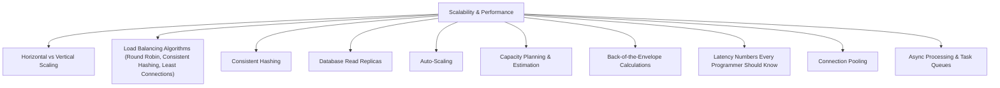
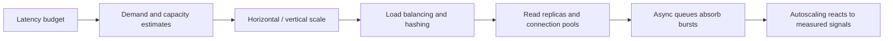

# Scalability & Performance (Module 10)

One standalone public repository for all Module 10 topics. Every topic has a guide, runnable Java 21 example or focused simulation, focused test, explicit trade-offs, and an authoritative source with a note about its relevance. No external infrastructure or cloud account is required.

## Topic map

## Complete topic coverage
| Topic guide | Runnable example | Test |
|---|---|---|
| [Horizontal vs Vertical Scaling](scaling/README.md) | [Example](scaling/src/main/java/example/Example.java) | [Test](scaling/src/test/java/example/ExampleTest.java) |
| [Load Balancing Algorithms (Round Robin, Consistent Hashing, Least Connections)](load-balancing/README.md) | [Example](load-balancing/src/main/java/example/Example.java) | [Test](load-balancing/src/test/java/example/ExampleTest.java) |
| [Consistent Hashing](consistent-hashing/README.md) | [Example](consistent-hashing/src/main/java/example/Example.java) | [Test](consistent-hashing/src/test/java/example/ExampleTest.java) |
| [Database Read Replicas](read-replicas/README.md) | [Example](read-replicas/src/main/java/example/Example.java) | [Test](read-replicas/src/test/java/example/ExampleTest.java) |
| [Auto-Scaling](autoscaling/README.md) | [Example](autoscaling/src/main/java/example/Example.java) | [Test](autoscaling/src/test/java/example/ExampleTest.java) |
| [Capacity Planning & Estimation](capacity-planning/README.md) | [Example](capacity-planning/src/main/java/example/Example.java) | [Test](capacity-planning/src/test/java/example/ExampleTest.java) |
| [Back-of-the-Envelope Calculations](napkin-math/README.md) | [Example](napkin-math/src/main/java/example/Example.java) | [Test](napkin-math/src/test/java/example/ExampleTest.java) |
| [Latency Numbers Every Programmer Should Know](latency/README.md) | [Example](latency/src/main/java/example/Example.java) | [Test](latency/src/test/java/example/ExampleTest.java) |
| [Connection Pooling](connection-pooling/README.md) | [Example](connection-pooling/src/main/java/example/Example.java) | [Test](connection-pooling/src/test/java/example/ExampleTest.java) |
| [Async Processing & Task Queues](async-processing/README.md) | [Example](async-processing/src/main/java/example/Example.java) | [Test](async-processing/src/test/java/example/ExampleTest.java) |

## Build and run
Install JDK 21. At repository root run `./gradlew test`, `./gradlew build`, or `./gradlew :capacity-planning:runExample`. Run any simulation using `./gradlew :<topic>:runExample`. A single Gradle 9.8.1 wrapper and Java 21 toolchain serve all topic projects; tests use JUnit 5.

## Capacity path

All performance constants are illustrative unless the guide says otherwise. Validate sizing and latency assumptions with workload-specific measurements.
